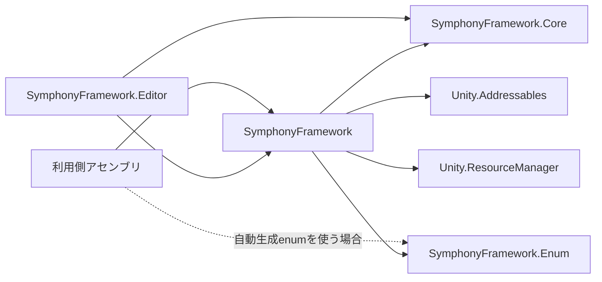
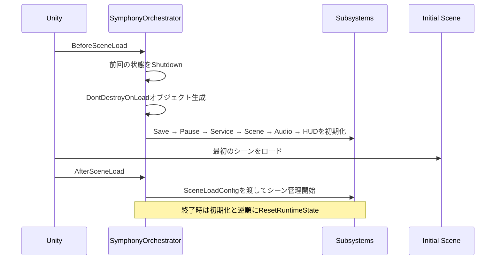
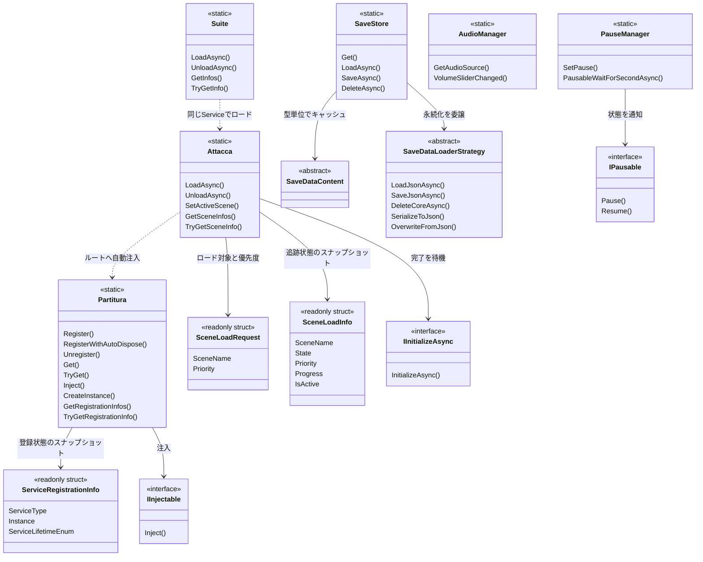
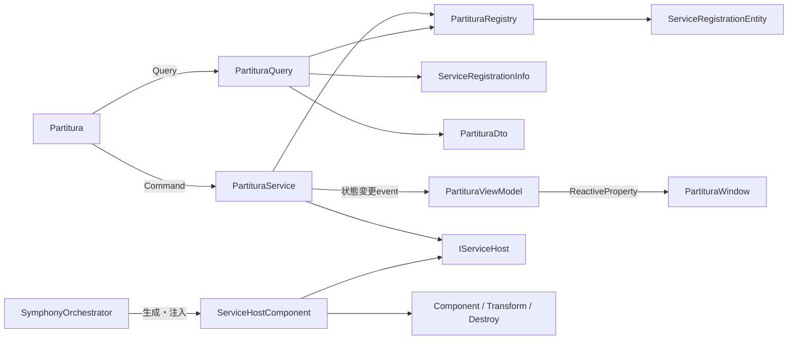
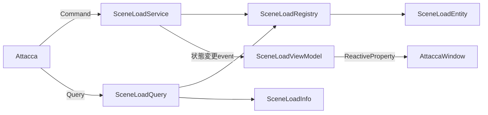
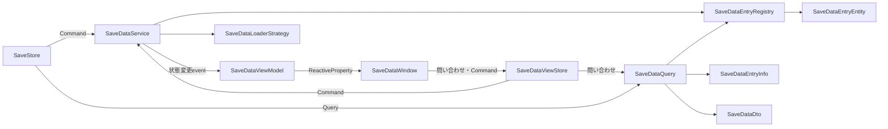
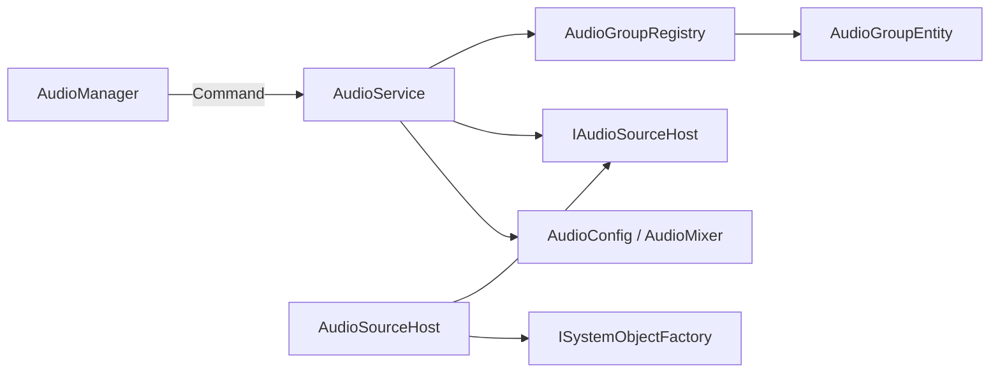
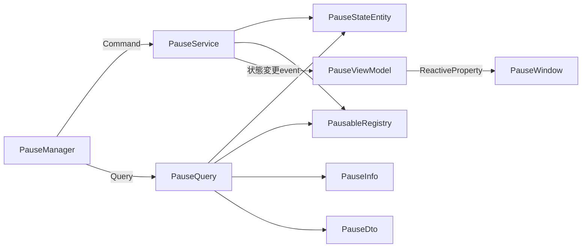

# モジュールの内部構造

この文書は、フレームワーク本体を開発する人向けに、各モジュールの内部のクラス構成をまとめたものです。利用者向けのモジュール文書（`Assets/SymphonyFramework/Documentation~/Modules/`）には、使うための情報だけを載せ、内部構造はここへ置きます。

- 置き場所を分けた経緯は [Designs/UserFacingModuleDocuments.md](./Designs/UserFacingModuleDocuments.md) にあります。
- 層の考え方は [DesignPhilosophy.md](./DesignPhilosophy.md) にあります。
- 内部構造を変えたときは、この文書の該当する節を同じ変更で直します。

## 全体

### アセンブリの参照

- `SymphonyFramework`: Runtime API、Component、設定型、Utilityを含むメインアセンブリ。
- `SymphonyFramework.Core`: RuntimeとEditorが共有する定数・基盤。利用側が通常直接参照する必要はない。
- `SymphonyFramework.Editor`: Editor専用の設定画面、管理ウィンドウ、Drawer、Generator。Playerビルドには含まれない。
- `SymphonyFramework.Enum`: 利用プロジェクトのScene、Tag、Layer、Audio Groupから生成されるアセンブリ。利用する場合だけ消費者側asmdefから参照する。

参照方向は`Editor → Runtime → Core`です。RuntimeまたはCoreからEditorへ逆参照しません。

### 起動と終了

`SymphonyOrchestrator`がComposition Rootです。利用側でBootstrapを作る必要はありません。

Play ModeのDomain Reloadが無効でも状態を持ち越さないよう、開始時に既存状態を破棄し、終了時は初期化済みサブシステムを逆順で解放します。

### 公開Facadeと拡張点

Facadeは利用側の入口、interfaceと抽象classは利用側が実装する拡張点です。ConfigとManagerの内部実装はFacadeの背後に隠し、利用側へ公開しません。

### シーンロード時の連携

```mermaid
flowchart TD
    Request["Attacca.LoadAsync / Suite.LoadAsync"] --> Load["シーンを非同期ロード"]
    Load --> Roots["ルートGameObjectを走査"]
    Roots --> Inject{"IInjectableを実装?"}
    Inject -- Yes --> Resolve["Partituraから依存を解決して注入"]
    Inject -- No --> Initialize
    Resolve --> Initialize{"IInitializeAsyncを実装?"}
    Initialize -- Yes --> Await["InitializeAsyncの完了を待機"]
    Initialize -- No --> Complete["優先度を評価してロード完了"]
    Await --> Complete
    Resolve -. "失敗" .-> Exception["SceneInitializationException"]
    Await -. "失敗" .-> Exception
```

この連携が必要なシーンではUnity標準の`SceneManager.LoadScene`を直接使わず、`Attacca`か`Suite`を入口にします。

## Partitura

PartituraのRuntime内部では、登録Command、読み取り変換、表示状態、Unity所有処理を分離しています。

`PartituraQuery`だけがRegistry／Entityを読み取り、利用側には`ServiceRegistrationInfo`、Viewには内部Dtoを返します。`PartituraWindow`はViewModelを購読し、登録状態が変わったときだけ再描画します。

通常登録が型重複で失敗しても候補payloadを解放しません。`RegisterWithAutoDispose`を選んだ場合だけ、失敗した候補を`ServiceHostComponent`が`IDisposable`またはComponentとして解放します。RegistryとEntityはUnity APIを参照しません。

## Attacca

Attaccaの内部では、Commandと読み取りを分離しています。

`SceneLoadQuery`だけがRegistry／Entityを読み取り、利用側には`SceneLoadInfo`、Viewには内部Dtoを返します。`AttaccaWindow`はViewModelを購読し、RuntimeのRegistryやEntityを直接参照しません。

## Suite

`Suite` は `Attacca` の内部Service（`SceneLoadService`）を土台にして動きます。`SymphonyOrchestrator` が `Attacca` の初期化後に `Suite` を初期化し、終了処理は登録の逆順で実行します。

| 層 | 型 | 役割 |
| --- | --- | --- |
| Adaptor | `Suite` | 公開エントリポイント |
| Application | `SuiteService` | 層順のロードと保持規則の実行 |
| Application | `SuiteRegistry` | ブロックの追跡と、シーンごとの保持元の記録 |
| Domain | `SuiteLoadEntity` | ブロック1件の実行計画と状態 |
| Domain | `SuiteGraphPlanner` | 依存グラフの検証とトポロジカル層の算出 |

依存は `Suite` → `Attacca` の一方向です。`Attacca.UnloadAsync` が Suite の保持中シーンを拒否するための判定（`Suite.IsSceneHeld`）は、Orchestrator が `Attacca.SetSuiteHoldQuery` で関数として渡します。Attacca から Suite の型は参照しません。

起動時の Suite（`SceneLoadConfig` の「初期化時にロードするSuite」）も Orchestrator が組み立てます。シーン名の集合と、`Suite.LoadInitialAsync` を呼ぶ関数を `Attacca.AfterSceneLoad` へ渡し、`SceneLoadService` が「初期シーン → Suite → 残りの整理」の順に実行します。

## Save Data System

Save DataのRuntime内部も同じ形で、処理順、読み取り変換、表示状態を分離しています。

`SaveDataQuery`だけがRegistry／Entityを読み取り、利用側には`SaveDataEntryInfo`、Viewには内部Dtoを返します。`SaveDataWindow`は表示状態を`SaveDataViewModel`から購読し、操作と問い合わせは`SaveDataViewStore`へ送ります。状態が変わったときにバインド元を評価し、解決した状態が変わった場合、または接続中のRegistry正本が差し替わった場合だけInspectorを再バインドします。

`SaveDataViewStore`は表示状態を持たず、問い合わせをQueryへ、CommandをServiceへ委譲します。Window専用インスタンスのLoad／Save／DeleteはServiceのdetached操作へ渡され、通常操作と同じLoaderと例外変換を使いますが、Registryを読み書きせず、状態変更eventも発行しません。

永続化データが存在するかどうか（`Exists`）はQueryに含めません。ローダーへのI/Oであり、状態が変わるたびに全型分の問い合わせが走るためです。

## Audio Manager

Audioは読み取り経路の利用者（Editor WindowとMCP診断）が無いため、QueryとViewModelを持ちません。

`AudioSourceHost`は**最初にAudioSourceを求められた時点で初めてGameObjectを生成します。** AudioMixerが未割り当てなどでAudioSourceを1つも作らない場合、GameObjectも作られません。

## Pause Manager

Pauseも同じ形で、状態の保持、購読の管理、表示状態を分離しています。

`PauseStateEntity`が「状態が実際に変化したか」を判定するため、同じ値の再設定では`OnPauseChanged`を発行しません。

`OnPauseChanged`（利用側が購読する公開event）の購読者例外は握りません。`OnStateChanged`（表示専用）だけは発行側で捕捉してログへ出し、ViewModelの失敗をゲーム側のポーズ処理へ波及させません。

## Build Validation

| 型 | 役割 |
| --- | --- |
| BuildValidationConfig / BuildValidationSettingProvider | 設定の保存とProject Settings画面 |
| BuildValidationMenu / BuildValidationBuildProcessor | 手動実行とビルド前処理の入口 |
| UxmlDependencyValidator / UxmlSourceReference | Unity上の依存検査と、Unity APIを使わない参照文字列の解析 |
| FontSettingsValidator / FontSnapshot | SerializedObjectからの読み取りと、取得した値だけによる規則判定 |
| BuildValidationReport | エラー一覧と結果メッセージ |

実装はすべてEditorアセンブリ内にあり、検証用の公開APIは追加しません。自動初期化や常時ポーリングも行いません。
